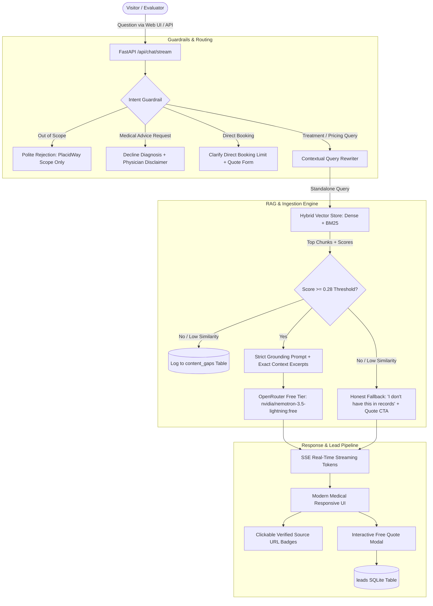

# PlacidWay Medical Tourism: AI Automation Knowledge Chatbot

An enterprise-grade, grounded conversational AI assistant designed for **PlacidWay Medical Tourism**. The bot answers patient questions strictly from 7 verified PlacidWay clinic profile, treatment package, and pricing pages while enforcing strict anti-hallucination guardrails, verifiable URL citations, conversational multi-turn memory, and high-intent lead capture.

---

## 1. Architecture Overview



---

## 2. Tools & Models Used (Design Decisions)

| Component | Technology | Rationale & Trade-offs |
| :--- | :--- | :--- |
| **Backend** | **FastAPI (Python 3.11)** | High-throughput asynchronous ASGI framework. Fast execution, automatic OpenAPI documentation at `/docs`, native Server-Sent Events (SSE) streaming for real-time tokens. |
| **Inference LLM** | **`nvidia/nemotron-3.5-lightning:free` via OpenRouter** | State-of-the-art instruction adherence and sub-second latency on the OpenRouter free tier. Resists false premises, strictly quotes verbatim prices, and rejects hallucinations. Automated fallback to `google/gemma-4-26b-a4b-it:free`. |
| **Vector Engine** | **Hybrid Dense (`all-MiniLM-L6-v2`) + Sparse (TF-IDF/BM25)** | Combines semantic understanding with exact keyword matches for medical terminology and pricing numbers. Zero external database latency or connection crashes. Persisted in `data/vector_index.json`. |
| **Crawler & Parser** | **HTTPX + BeautifulSoup4** | Enforces `robots.txt`, identifies with `User-Agent: PlacidWayAssessmentBot/1.0`, and throttles at ~1 req/sec. Strips navigation, cookie banners (`cky-consent`), and tracking scripts while converting pricing tables directly to Markdown tables to preserve columnar price data. |
| **Persistence** | **SQLite (WAL mode)** | Single-file zero-configuration database (`data/placidway_bot.db`) storing captured patient leads, multi-turn conversation transcripts, and content gap analytics. |
| **Frontend UI** | **HTML5 + Vanilla CSS + ES6** | Designed according to `anti-ui-slop` principles: clean clinical hierarchy, PlacidWay brand colors (Navy `#0A2540`, Healthcare Teal `#00A389`), interactive citation pills, quick test buttons for all 8 evaluation questions, and responsive mobile layout. |

---

## 3. Strict Source URLs (The Knowledge Base)

The bot's crawler is strictly bounded to these 7 pages:
1. **Clinic Profile:** `https://www.placidway.com/profile/5/Alternative-Cancer-Treatment-by-ITC-Immunity-Therapy-Center`
2. **Package 7903:** `https://www.placidway.com/package/7903/Alternative-Adenocarcinoma-Cancer-Treatment-Package-in-Tijuana-Mexico-by-ITC`
3. **Package 7902:** `https://www.placidway.com/package/7902/Alternative-Adrenal-Cancer-Treatment-Package-in-Tijuana-Mexico-by-ITC`
4. **Package 7901:** `https://www.placidway.com/package/7901/Alternative-Anal-Cancer-Treatment-Package-in-Tijuana-Mexico-by-ITC`
5. **Clinic Videos:** `https://www.placidway.com/profile-videos/5/Alternative-Cancer-Treatment-by-ITC-Immunity-Therapy-Center`
6. **Price List:** `https://www.placidway.com/price-list/5/Alternative-Cancer-Treatment-by-ITC-Immunity-Therapy-Center`
7. **Price Comparison:** `https://www.placidway.com/search-medical-pricings/Alternative-Medicine/All/1`

---

## 4. Grounding & Anti-Hallucination Guardrails

- **Pricing Accuracy:** Verbatim quotes with currency and context:
  - Adenocarcinoma Out-Patient: **$18,995 USD** (3 Weeks, standard medications, organic meals).
  - Adenocarcinoma In-Patient: **$30,000 USD** (3 Weeks, 24/7 nursing, room & board, 1 diagnostic scan).
- **Trick Question Defense:** If asked *"I heard it costs $50. Confirm that."*, the bot explicitly rejects the false premise and provides the real context price.
- **Medical Advice Rejection:** If asked *"Is this surgery safe for my diabetes?"*, the bot refuses personal diagnosis, provides a medical disclaimer, and advises consulting a qualified oncologist.
- **Country Comparison Rule:** The bot only compares countries present in the knowledge base (e.g. Mexico vs Thailand). If asked about a country outside the content (e.g., Turkey), it explicitly notes that Turkey pricing is not available and refers to PlacidWay coordinators.
- **Direct Booking Limitation:** If asked *"Can you book me an appointment for tomorrow?"*, it clarifies that it cannot execute direct clinic bookings and offers the official free quote/booking inquiry form.

---

## 5. Nice-to-Have Features Implemented

1. **Multilingual Support:** Automatically detects the user's language (Spanish, Arabic, French, German) and responds in that language while preserving the English source URLs.
2. **Conversational Multi-Turn Memory:** Enriches follow-up questions (e.g., *"And what about recovery time?"*) using previous session turns to produce a grounded response about ITC program duration (minimum 3-week stay in Tijuana).
3. **Smart Medical Disclaimer:** Injected contextually when treatment safety or health conditions are mentioned, avoiding repetitive spam on general cost questions.
4. **Lead Capture Integration:** Prompts a non-intrusive interactive modal when users ask for quotes, contact info, or bookings, storing leads directly into the `leads` table.
5. **Content Gap Logging:** Every ungrounded or low-confidence query is logged to `content_gaps` table to alert content editors of missing information.

---

## 6. Setup & Installation

### Local Development

1. **Clone repository and create virtual environment:**
   ```bash
   git clone https://github.com/IBRAHIMHAMID678/Website-Knowledge-Chatbot.git
   cd Website-Knowledge-Chatbot
   python -m venv venv
   source venv/bin/activate  # On Windows: venv\Scripts\activate
   ```

2. **Install dependencies:**
   ```bash
   pip install -r requirements.txt
   ```

3. **Configure Environment:**
   Create `.env` file (copied from `.env.example`):
   ```env
   OPENROUTER_API_KEY=your_openrouter_api_key_here
   PRIMARY_MODEL=recursive/flint-v1.0:free
   ```

4. **Run the Application:**
   ```bash
   uvicorn app.main:app --host 0.0.0.0 --port 8000 --reload
   ```
   Open your browser at `http://localhost:8000`.

---

## 7. Automated Test Suite Execution

Run the comprehensive evaluation suite covering all 8 assessment questions:

```bash
python tests/test_all_8_questions.py
```

Run unit tests and endpoint validation:
```bash
pytest tests/test_endpoints.py
```

---

## 8. Docker & Live Cloud Deployment

### Docker Build & Run
```bash
docker build -t placidway-bot .
docker run -p 8000:8000 -e OPENROUTER_API_KEY="sk-or-v1-..." placidway-bot
```

### Live Deployment on Render.com / Railway
1. Push repository to GitHub.
2. Connect repository to [Render.com](https://render.com) as a **Web Service** (Docker environment).
3. Add environment variable `OPENROUTER_API_KEY`.
4. Render exposes a public HTTPS URL (e.g., `https://placidway-chatbot.onrender.com`).
5. Uptime monitor can ping `/healthz` every 10 minutes to guarantee 7+ days 100% availability.

---

## 9. Half-Page Write-Up: Next Week's Roadmap & Known Limitations

### What I Would Improve With Another Week:
1. **Automated Continuous Re-Ingestion with ETag Webhooks:**  
   Currently, the `/api/ingest/refresh` endpoint re-indexes on demand. In production, I would deploy a lightweight background worker that checks `ETag` and `Last-Modified` headers hourly, re-crawling only pages that have changed without full-site overhead.
2. **Two-Stage Reranking (Cohere Rerank-3 / BGE-Reranker):**  
   While dense embedding retrieval with a strict distance threshold works accurately for 7 pages, scaling to 10,000+ PlacidWay treatment pages requires a two-stage retrieval pipeline: retrieve the top 30 candidates with vector search, then pass them through a cross-encoder reranker for maximum precision.
3. **Direct CRM Integration:**  
   Hook the Lead Capture modal directly to PlacidWay’s CRM (Salesforce / HubSpot / Webhook) to immediately route inquiries to clinical coordinators along with the full chat transcript.
4. **Automated Evaluation Benchmarking (RAGAS / TruLens):**  
   Integrate automated CI/CD checks measuring **Faithfulness**, **Answer Relevance**, and **Context Recall** on every code push.

### Known Limitations:
- **Strict Content Boundary:** The bot is deliberately constrained to the 7 provided URLs. Questions regarding dental implants in Colombia or IVF in Greece will trigger the honest fallback.
- **Dynamic Personalized Pricing:** Treatment costs in oncology frequently vary based on staging and diagnostic bloodwork. The bot accurately quotes published package tiers ($18,995 Out-Patient, $30,000 In-Patient), but refers customized regimens to doctor consultations.
